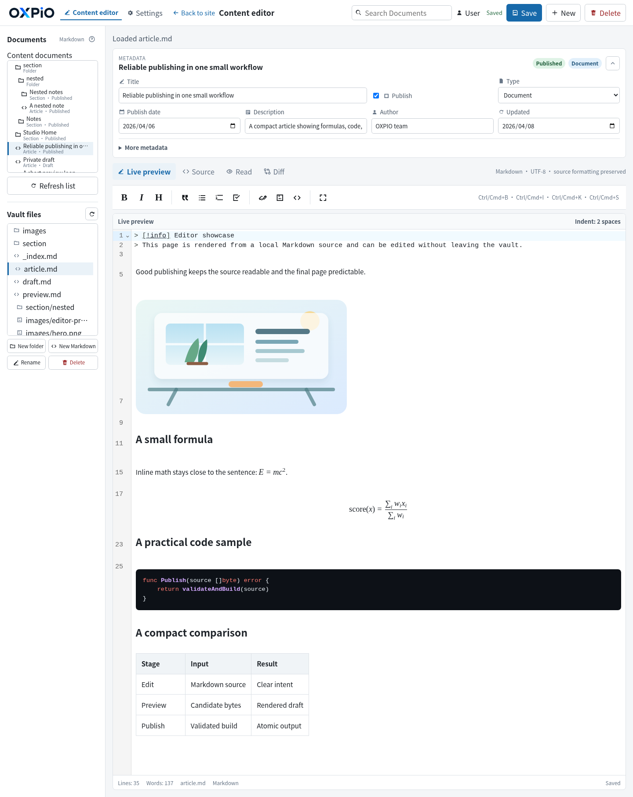
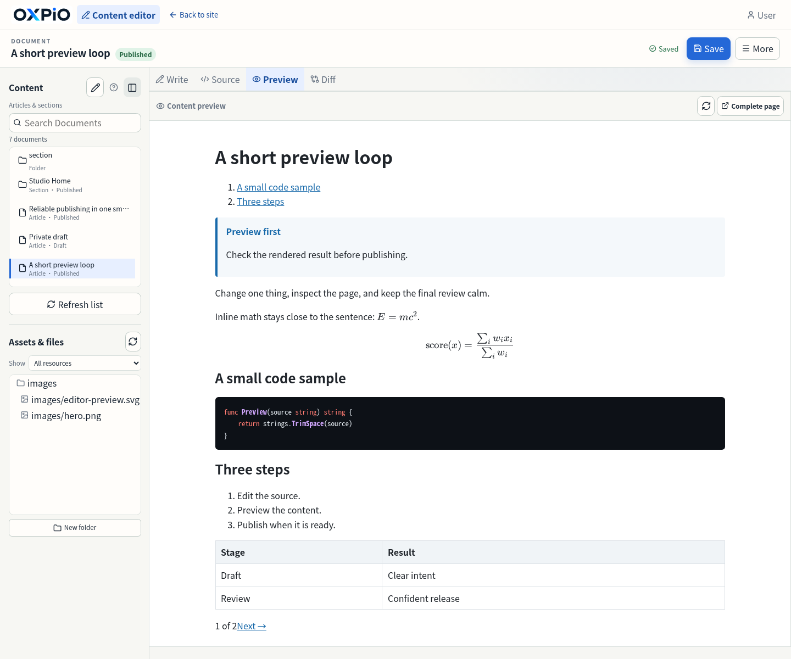
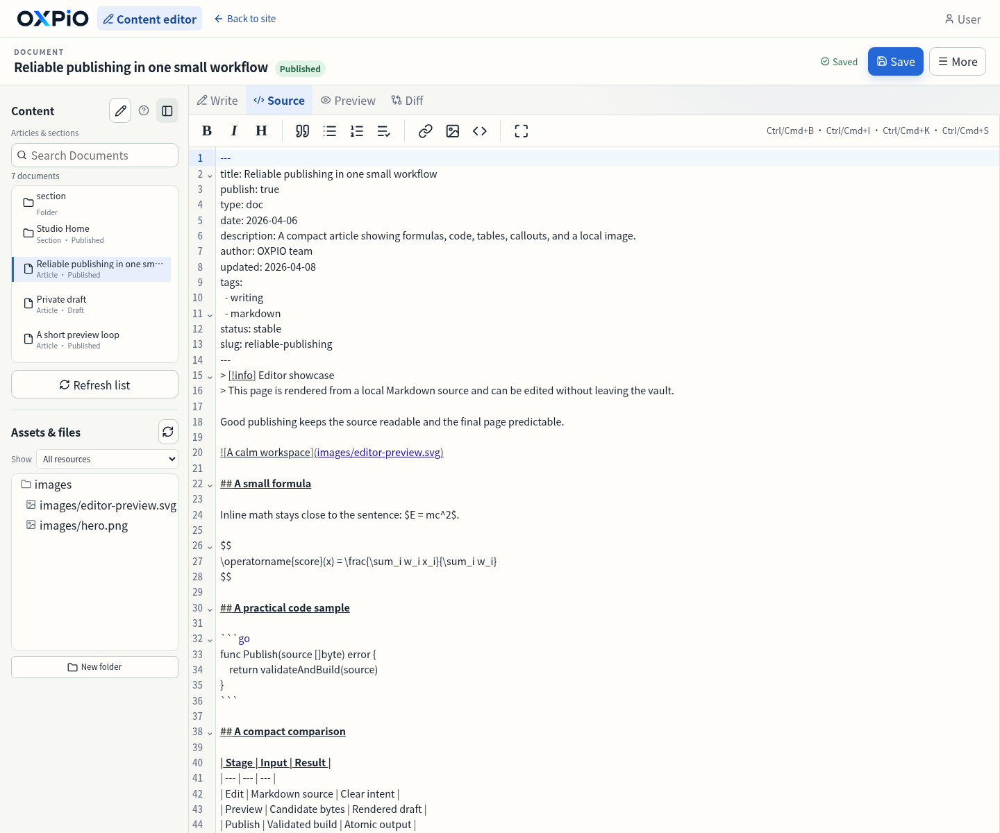
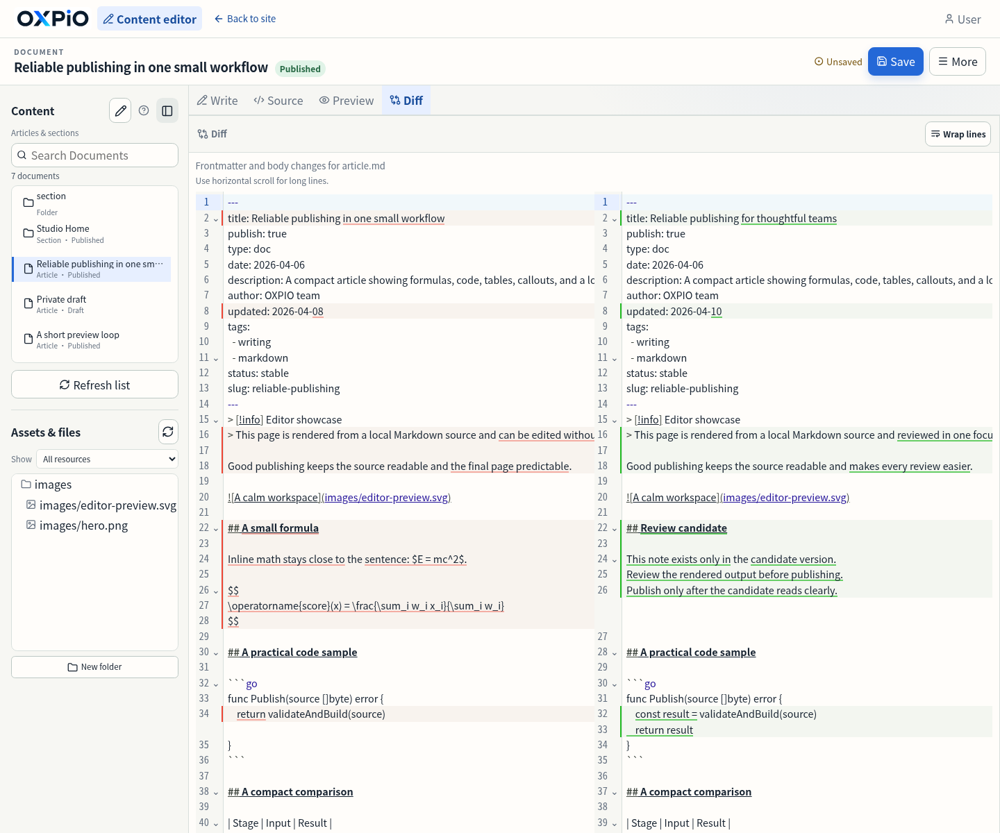

# OXPIO

<p align="center"></p>

```bash
cd vault && oxpio init && oxpio validate && oxpio publish && oxpio serve --watch
```

OXPIO is a self-contained Go CLI that publishes one OXPIO Vault as a deterministic static site. The vault is the only content source and `<vault>/oxpio.yaml` is the only site configuration. The generated site is written transactionally to `<vault>/public` by default.

## Online editing

OXPIO is also a focused online writing workspace. Run `oxpio editor`, open a Markdown source, edit frontmatter and content visually, preview the server-rendered draft, or switch to source mode when you need full control.

```bash
oxpio editor --vault ./vault --port 8080
```

The editor keeps the vault as the source of truth and publishes only after validation and a successful build. It includes a local CodeMirror Markdown editor, metadata form, toolbar, file manager, server-rendered draft preview, media library, responsive layout, Write/Source/Preview/Diff views, and safe save/rollback behavior. Live preview stays in one editor surface: the line under the pointer or cursor exposes Markdown while surrounding lines keep their rendered treatment. Use Preview for a complete server-rendered view. The English showcase article below intentionally exercises inline and block math, a Go code block, a Markdown table, a callout, and a local image.

<div align="center">
  <a href="docs/images/editor-live.png"></a>
  <a href="docs/images/editor-preview.png"></a>
</div>

<div align="center">
  <a href="docs/images/editor-source.png"></a>
  <a href="docs/images/editor-diff.png"></a>
</div>

<p align="center"><em>The captures show single-surface Live preview, the complete Preview view, full Markdown source, and source Diff for an unsaved candidate.</em></p>

## Commands

```text
oxpio help [COMMAND] [--vault PATH] [--output PATH]
oxpio init [--vault PATH]
oxpio validate [--vault PATH] [--output PATH]
oxpio publish [--vault PATH] [--output PATH] [--dry-run]
oxpio serve [--vault PATH] [--output PATH] [--port NUM] [--watch]
oxpio editor [--vault PATH] [--output PATH] [--port NUM] [--listen ADDRESS] [--setup|--reset-password]
oxpio context [--vault PATH] [--output PATH] [--include-unpublished]
oxpio read|write|edit|move|delete PATH ... [--output PATH]
oxpio find|ls|grep|tags|related ... [--vault PATH] [--output PATH]
oxpio upload|mkdir|rename-dir ... [--vault PATH] [--output PATH]
oxpio config read [--vault PATH]
oxpio config write|edit ... [--vault PATH] [--output PATH]
oxpio recover [--vault PATH] [--dry-run]
oxpio theme validate|init|write|edit|preview ... [--output PATH]
oxpio theme read|context ...
oxpio version
oxpio --version
```

Vault-analyzing query and mutation commands accept the same optional `--output` boundary; when omitted, it defaults to `<vault>/public`. This includes dynamic `help`, `context`, `find`, `ls`, `read`, `tags`, `grep`, `related`, source/config mutations, uploads and directory mutations, plus theme initialization/validation/writes. `config read`, `theme read`, and `theme context` are read-only and do not need an output boundary; `theme context` also inspects the selected configuration and local theme inventory. `theme preview --output` validates and excludes a custom formal output but never writes it.

`init` accepts only a nonexistent or completely empty directory. It creates a strict `oxpio.yaml` and a root `_index.md`, and never overwrites existing files. `validate` is read-only and returns a failure for either errors or warnings. It resolves `--output` exactly like `publish` (default `<vault>/public`); pass the same value when validating a custom-output publish. Only that resolved path is excluded as the formal output boundary. OXPIO does not infer additional output boundaries from directory names or existing `.oxpio-output` markers; the normal fixed vault-input exclusions still apply. `publish` always uses the strict quality policy. Non-dry-run `publish`, `serve --watch`, and ordinary `editor` can replace the formal output; `publish --dry-run` performs generation and validation in ephemeral storage without changing output. Ordinary `serve` only serves the existing output. `editor --setup` and `editor --reset-password` only configure the account and do not start a publishing server. `serve --watch` uses the same shared publish service and reloads only after a successful publish. `serve` never registers editor or login routes.

### Optional editor mode

Enable the single-account editor explicitly with:

```bash
oxpio editor --vault ./vault --port 8080
```

The command runs a strict publish before listening and serves the generated site anonymously. The default listener is loopback (`oxpio editor --listen 127.0.0.1 --port 8080`); binding all interfaces requires the explicit `--listen 0.0.0.0` option. Configure an account interactively once with `oxpio editor --setup --vault ./vault`; setup requires a terminal, refuses an existing or invalid account, writes only an Argon2id PHC hash atomically, and never prints the password. Use `oxpio editor --reset-password --vault ./vault` to replace the password while preserving the username; setup/reset do not publish or start a listener. The strict `editor` section contains only `username` and `passwordHash`:

```yaml
editor:
  username: admin
  passwordHash: $argon2id$v=19$m=65536,t=3,p=1$...
```

After login, mapped article and section pages show an in-memory edit link. The embedded editor uses a locally bundled CodeMirror 6 Markdown editor with Markdown shortcuts, a toolbar, a frontmatter form that hides YAML by default, and a source mode for advanced edits. It supports server-rendered draft previews, an authenticated single-file Markdown/image upload to the Vault root or a selected existing folder, and local assets without CDN requests. Uploads never overwrite files or create parent folders implicitly. Preview/Diff uses the bundled CodeMirror Merge extension while rich preview continues through OXPIO's Go renderer; uncommitted candidates use same-origin IndexedDB and browser preferences use local browser storage only, never triggering a build. Draft recovery offers restore or discard when the server version changes; discard and successful save clean the path's drafts, and storage-quota failures remain visible. It preserves submitted source bytes, validates and rebuilds before an atomic source/output transaction, and reports warnings or build failures. New articles are drafts by default (`title`, `publish: false`, `type: doc`); posts require an explicit date. The File Manager supports creating folders and Markdown files, renaming managed article sources, and confirmed deletion with section/resource protection, path validation, and SHA-256 CAS checks. Failures do not reload the public site. `serve` is anonymous and read-only; `serve --watch` may replace formal output through the shared publish service but never writes source or configuration.

## Agent queries and the golden workflow

OXPIO has no visitor-facing site search. `oxpio grep QUERY` is a local, native Agent source search over the normalized Markdown catalog: it performs Unicode-folded literal matching by default, supports RE2 with zero-width rejection, `source|body|title|path|metadata|all` scopes, explicit path/section/tag/type/status/publish filters, merged `--context` windows, stable JSON results and fixed resource limits. It never invokes external `grep`/`rg`, reads generated HTML, or changes the production related-recommendation algorithm. Use `oxpio related PATH` separately for production article recommendations; it accepts only a published ordinary article and returns the same pipeline results used by pages. Hidden source queries require explicit `--include-unpublished`.

Machine mode uses `--format json` and the versioned JSON envelope `{schema, ok, command, data, diagnostics, changes}`. Diagnostics and changes use stable codes, severities, domains and SHA-256 hashes; exit codes distinguish success, quality/transaction failure, invalid arguments, CAS conflict, permission denial and I/O/service failure. `--content-file -` and `--edits-file -` are raw source bytes and strict PatchRequest JSON respectively; `upload --file -` is raw single-file bytes with `--name`. These stdin modes are not interchangeable. Agent operations are offline, do not parse human logs, and source-only mutations never publish. OXPIO does not provide MCP, a remote Agent API, GitHub Pages, S3, OSS or other deployment adapters; publish produces a local static output for a user-managed HTTP server or deployment tool.

A complete offline workflow is:

```bash
oxpio init --vault ./vault
# edit oxpio.yaml, root/section _index.md and Markdown articles
oxpio theme init --vault ./vault                 # optional editable minimal theme
# optionally select theme: minimal through config edit/write
oxpio validate --vault ./vault --output ./site
oxpio publish --vault ./vault --output ./site
oxpio serve --vault ./vault --output ./site
```

Agents can use `help --agent`/`context`, then `find`/`ls`/`read`, `write` or exact `edit` with CAS, `validate`, optional `publish --dry-run`, and explicit `publish`. `theme context`/`theme read` → `theme write`/`theme edit` → `theme validate`/`theme preview` is the isolated theme feedback loop. Source-only Agent mutations never publish or reload; editor saves/uploads/deletes run strict analysis and publish before reload; failed editor builds keep the previous page and can be retried. `serve --watch` performs the initial strict publish, retries failed rebuilds on later valid events, and reloads only after success. Published output includes the configured RSS, Sitemap, robots, Sidebar and popover artifacts when enabled and can be served by any ordinary static HTTP server.

## Vault and section model

A publishable vault must contain a root `_index.md`. Every content directory must contain exactly one `_index.md`; a section source is never an article. Section frontmatter allows only:

```yaml
---
title: Documentation
publish: true
description: Public documentation.
order: 1
banner: images/docs-banner.png
bannerAlt: Documentation banner
---
```

`title` and `publish` are required. Section routes are derived from their vault-relative directory (`/` for the root and `/guide/` for `guide`). A published section produces a landing page with its own body, direct child sections, direct published articles, breadcrumbs, navigation, and optional banner. `publish: false` hides the section and all descendants and is diagnosed when a descendant attempts to publish.

Ordinary articles also require explicit `title`, `publish`, and `type`. `type` is one of `doc`, `post`, or `page`:

```yaml
---
title: Getting Started
publish: true
type: doc
order: 1
description: A short description.
tags: [guide]
author: Documentation Team
status: stable
---
```

Document ordering uses explicit `order`, filename numeric prefix, normalized title, and normalized source path. A complete tie on the prescribed keys is rejected rather than resolved by an implementation-specific fallback; the same rule applies to post and page lists. Document pages expose one collection's previous/next flow and position. Posts require an explicit date, are ordered by date, and are the only article type included in RSS. Pages are standalone. No title, `publish`, date, or folder page is inferred from filenames or filesystem time. By default, an article route appends a segment derived from the source basename: `.md` and one leading decimal numeric prefix together with its following `-`, `_`, `.`, or space separator are removed. Renaming the source file therefore changes its public URL unless the article defines an explicit `slug`, which replaces the basename-derived segment.

## Configuration

YAML keys, values, nulls, and nested structures are strict. Unknown keys, duplicate keys, removed legacy fields, invalid paths, and invalid values are errors. `navigation` is required even when empty:

```yaml
baseURL: https://example.com/docs/
title: My OXPIO Site
author: Site Team
description: Project documentation.
language: en
navigation:
  - name: Home
    section: .
  - name: Repository
    url: https://github.com/example/project
source:
  editURL: https://github.com/example/project/edit/main/:path
  viewURL: https://github.com/example/project/blob/main/:path
versions:
  root: docs
  default: v2
  entries:
    - id: v1
      label: Version 1
      source: v1
    - id: v2
      label: Version 2
      source: v2
sidebar:
  enabled: true
popover:
  enabled: true
related:
  enabled: true
  count: 5
rss:
  enabled: true
timeline:
  enabled: false
  path: timeline
defaultImg: ""
```

The optional top-level keys `theme`, `pagination.pageSize`, and `attachments.directory` select a built-in or local theme, set the list page size (`1..1000`), and identify an existing Vault-relative attachment directory. Navigation entries use exactly one site-relative `url` or section reference. Site-relative links honor `baseURL`; external HTTP(S) links are rendered as supplied and are never requested. Source `editURL` and `viewURL` are independent absolute templates with exactly one `:path`; each source path segment is RFC 3986 percent-encoded.

Explicit `versions` create independent section trees, sidebars, routes, canonical URLs, sitemaps, breadcrumbs, reading flows, source paths, and static version selectors. Cross-version identity is source-based: a section uses its directory path relative to the entry's `source` (the version root is the empty relative path), and an article uses its Markdown source path relative to that directory, including its filename and `.md` extension. After separators are represented as `/`, the complete relative path is Unicode NFKC-normalized and case-folded. Slugs, titles, generated routes, and numeric-prefix removal do not participate. Therefore matching `intro.md` sources stay linked when their slugs differ; if no published page of the same kind has the same identity key, the selector links to the target version root and never falls back to another version's content.

### `defaultImg`

`defaultImg` has only two non-empty meanings:

1. An absolute HTTP(S) URL with a host is an explicit hosted image URL.
2. A normalized vault-relative path is a local planned asset.

Empty means no default image. Local paths must be contained regular files and cannot contain query/fragment syntax, backslashes, traversal, or symlinks. OXPIO never downloads an image.

## Rendering and metadata

The selected Go `html/template` theme is server-rendered and usable without JavaScript; local themes can replace the complete page shell. It includes global navigation, section/version context, breadcrumbs, Sidebar data, source links, semantic landmarks, canonical URLs, descriptions, Open Graph/Twitter metadata, JSON-LD, RSS, Sitemap, robots, 404, and a shared offline runtime. Markdown supports the built-in wikilink, embed, callout, hashtag, heading/TOC, highlighting, raw-HTML, math, Mermaid, and attachment behavior; unresolved links and unsupported syntax become deterministic diagnostics without hiding authored content.

YouTube/Vimeo URLs in Markdown image syntax remain image destinations; OXPIO does not convert them into remote players. Use ordinary Markdown links for online videos. Authored external images and raw HTML can still initiate browser requests; fully offline content must use local resources.

The optional article metadata fields are `date`, `updated`, `tags`, `aliases`, `slug`, `order`, `author`, `reviewed`, `status`, `audience`, `productVersion`, `series`, `cover`, `banner`, and `bannerAlt`. Dates are normalized to UTC. A banner requires a non-empty matching `bannerAlt`, is published once through the asset planner, and appears only in its owning section or article header. Banners use a responsive `16:5` display ratio with `object-fit: cover` and a 280px maximum height. Covers are local PNG, JPEG, or WebP files and are used only as social-card source images.

`status: deprecated` emits an explicit text notice independent of color or JavaScript. Metadata is omitted when its optional source value is absent; no current time or filesystem fallback is inserted.

## Page-level social cards

Every published `doc`, `post`, and `page` article receives one deterministic 1200×630 PNG. Cards use the fixed text-first colors and geometry, an optional center-cropped cover, an embedded audited font, grapheme-aware truncation, and no clock, random, browser, system-font, CDN, or network input. The final URL is content-addressed under:

```text
assets/social/<sha256(canonical-article-url)>/<sha256(canonical-card-input)>-<sha256(png-bytes)>.png
```

Article `og:image` and `twitter:image` point to that generated local PNG with `summary_large_image`. Sections never receive article social cards, and banners are not implicitly used as cards.

The canonical card input has this fixed compact-JSON key order:

```text
canonicalURL, siteTitle, title, context, description?, date?, updated?, tags?,
aliases?, slug?, type?, order?, author?, reviewed?, status?, audience?,
productVersion?, series?, coverHash?, generator
```

`context` is the normalized section title followed by ` / ` and the version label when a version is present. The `?` fields are omitted when absent after trimming; `publish` controls card eligibility rather than identity. `coverHash` is the SHA-256 of the cover bytes, while the cover path and banner metadata are not card inputs. Dates are UTC RFC3339 values. Tags are canonicalized, deduplicated and sorted by UTF-8 bytes; aliases retain the first text and YAML order after NFKC/case-fold deduplication; other lists retain their normalized order. `order` is numeric. All strings are normalized before rendering, and the JSON is UTF-8, compact, and emitted in the order above. Changes to any included field, including non-visible metadata such as `description`, `reviewed`, or `type`, change the content-addressed URL; changes to visible values also change PNG bytes.

## Assets, themes, and offline runtime

All source assets pass through one contained asset planner. The planner owns Markdown images/embeds, raw HTML resources, recursive local CSS dependencies, banners, covers, local `defaultImg`, selected-theme assets, and output collision checks. The generated output contains one shared content-addressed runtime, offline KaTeX/Mermaid resources, one optional Sidebar JSON, structural CSS, the selected Go `html/template` theme, and optional vault-root `custom.css`. Themes use the complete `oxpio.theme.vm/v1` View Model and can replace the HTML shell; no runtime resource is downloaded and no public Go SDK is provided.

Themes live under `.oxpio/themes/<theme-id>/` and require `theme.yaml`, `layouts/base.html`, `section.html`, `article.html`, `tag.html`, `timeline.html`, and `404.html`, plus `partials/` and `assets/` directories (either may be empty). The embedded `base` theme is selected by default; `oxpio theme init` creates an editable `minimal` copy. Theme resources are planned with content-addressed URLs and are referenced from templates with `{{assetURL "assets/name.css"}}`. CSS dependencies and missing resources are validated before publication.

Theme development uses `oxpio theme context`, `theme read`, `theme write`/`theme edit` with CAS hashes, `theme validate --theme ID`, and the isolated `theme preview --theme ID`. JSON context exposes the selected theme inventory in `theme.files` and the complete inventory in every local `availableThemes[].files` entry, including Vault-relative path, kind, SHA-256, size, and root `custom.css` when present; embedded `base` reports identity only. Templates receive the immutable `oxpio.theme.vm/v1` View Model and may use only `siteURL`, `routeURL`, `assetURL`, `formatDate`, and `emitJSONLD`; theme tools never publish or modify Markdown/config selection. Run `oxpio publish` explicitly after selecting a local theme.

## Related recommendations

Related recommendations use one fixed dynamic TF-IDF, sparse-cosine, source-only link/tag algorithm. `related.enabled` is a boolean feature switch (`true` or `false`); `related.count` is an integer restricted to `1..20`, including when recommendations are disabled. Published `doc`, `post`, and `page` articles are ranked only against articles in the same version partition; sections and unpublished content do not affect DF, IDF, tags, or candidates.

The normative [related recommendation acceptance contract](docs/related-recommendations.md) fixes every formula, weight, threshold and limit, the tokenizer rules and resource hashes, source/candidate corpus boundaries, ranking order, and calibration evidence. These internals are not user-configurable.

## Install and development

Release archives contain one `CGO_ENABLED=0` executable, the project license, and third-party notices. Verify the published SHA-256 checksums. Source installation requires Go 1.25 or newer:

```bash
go install github.com/simp-lee/oxpio/cmd/oxpio@vX.Y.Z
```

Go 1.25 is the minimum declared Go version; this does not mean every Go 1.25 patch release is covered by CI. CI and release validation use Go 1.26.2, and the dedicated related-performance host check also requires Go 1.26.2. Development checks use pinned Go, Node.js, Playwright, GoReleaser, actionlint, golangci-lint, gofumpt, and goimports versions:

```bash
make tools
make check
sh scripts/go-test-nonempty.sh -race ./internal/analyze ./internal/build ./internal/cli ./internal/edit ./internal/render ./internal/server ./internal/recommend/... ./internal/vault ./internal/link
npm ci
npm run build:editor
npx --no-install playwright install chromium
npm run test:e2e
```

OXPIO does not provide site search, migration of old vault formats, online search, a database, or external runtime downloads.
