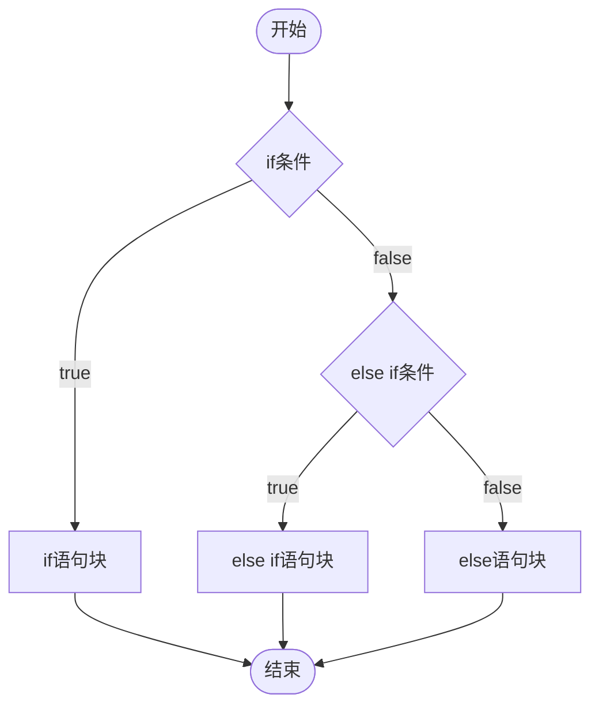
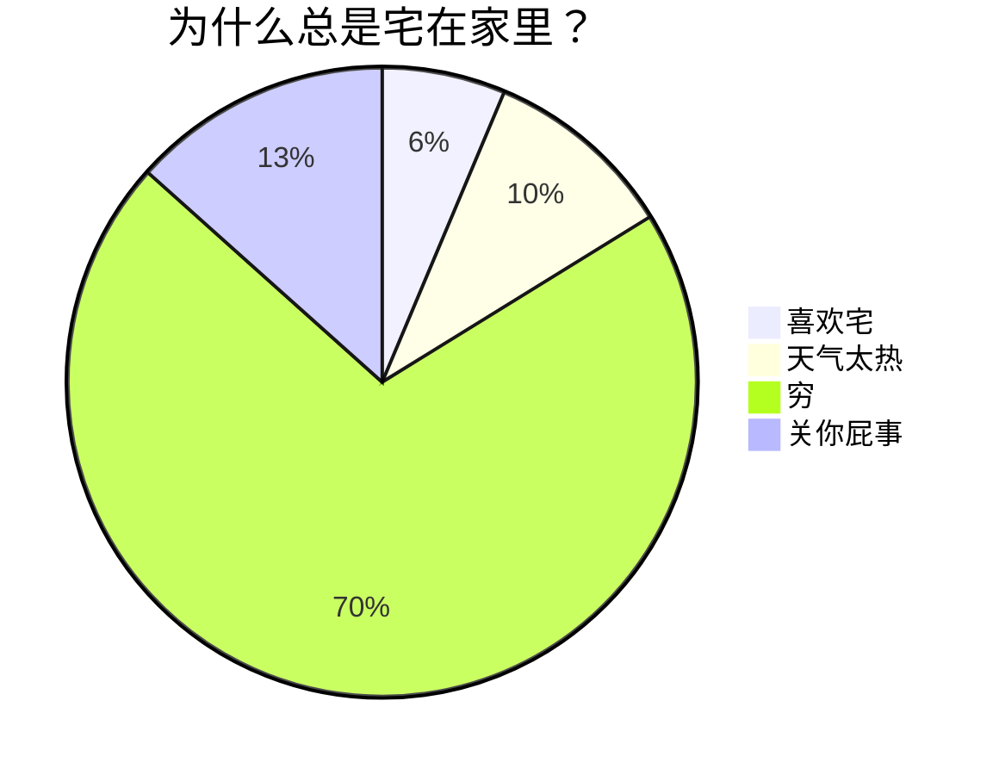

# Live Preview syntax gallery

<!-- 这里是一行注释 -->

<!--
这里是
一段
假装有
很多行的
注释
-->

- [ ] 待办任务列表1
- [x] 已办任务列表2

## Basic
- [ ] to-do
- [/] incomplete
- [x] done
- [-] canceled
- [>] forwarded
- [<] scheduling

## Extras
- [?] question
- [!] important
- [*] star
- ["] quote
- [l] location
- [b] bookmark
- [i] information
- [S] savings
- [I] idea
- [p] pros
- [c] cons
- [f] fire
- [k] key
- [w] win
- [u] up
- [d] down
- [D] draft pull request
- [P] open pull request
- [M] merged pull request

鲁迅原名是什么[^1]，浙江哪里人[^2]

%%这里是变量区%%

[^1]: 周树人
[^2]: 绍兴人

Inline **strong**, *emphasis*, ~~strike~~, [link](https://example.test), and `code`.

Inline math: $E = mc^2$, chemistry: $\ce{H_2O}$, escaped delimiters: \(a^2 + b^2 = c^2\), and `code`.

$$
\ce{Zn^2+  <=>[+ 2OH-][+ 2H+]  $\underset{\text{amphoteres Hydroxid}}{\ce{Zn(OH)2 v}}$  <=>[+ 2OH-][+ 2H+]  $\underset{\text{Hydroxozikat}}{\ce{[Zn(OH)4]^2-}}$}
$$

$$
\begin{array}{lll}
\nabla\times E &=& -\;\frac{\partial{B}}{\partial{t}} \\
\nabla\times H &=& \frac{\partial{D}}{\partial{t}}+J \\
\nabla\cdot D &=& \rho \\
\nabla\cdot B &=& 0
\end{array}
$$





> [!NOTE]
> Highlights information that users should take into account, even when skimming.

> [!TIP]
> Optional information to help a user be more successful.

> [!IMPORTANT]
> Crucial information necessary for users to succeed.

> [!WARNING]
> Critical content demanding immediate user attention due to potential risks.

> [!CAUTION]
> Negative potential consequences of an action.

## More GFM

| Feature | Status | Example |
| --- | --- | --- |
| **Strong** | ✅ | [link](https://example.test) |
| ~~Strike~~ | ready | `inline code` |
| *Emphasis* | ready | semantic HTML |

1. Ordered item
2. Another item

> A regular quote with a footnote[^3].

[^3]: A second footnote definition.

---

```go
func localPreview() string { return "WASM" }
```
